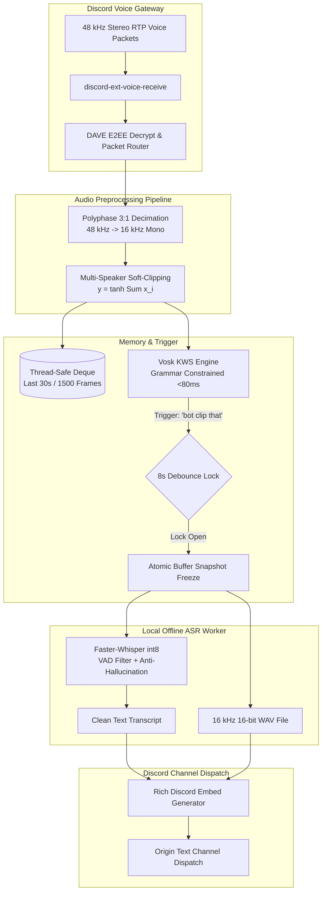

# Discord Voice Clipper & Meeting Assistant Bot
> **100% Offline, Privacy-Preserving Retroactive Voice Clipper and Instant Meeting Minutes Generator for Discord.**

[](https://www.python.org/)
[](https://discordpy.readthedocs.io/)
[-green.svg)](https://github.com/SYSTRAN/faster-whisper)
[-orange.svg)](https://alphacephei.com/vosk/)
[](tests/)
[](evaluation_report.md)

---

## 📖 Overview

During collaborative voice meetings, verbal agreements, task assignments, and technical decisions are frequently lost to **"meeting amnesia."** Taking manual notes breaks conversational flow, while traditional cloud recording bots introduce privacy risks, costly API billing, and massive unindexed audio recordings.

**Discord Voice Clipper** solves this by maintaining a thread-safe, in-memory **30-second rolling ring buffer**. When someone speaks the wake word:

$$\text{"bot clip that"}$$

The bot instantly freezes the preceding 30 seconds of audio, downmixes and soft-clips multi-speaker streams, transcribes the speech completely offline using quantized Faster-Whisper, and posts a structured Discord Embed with the transcript and an uncompressed 16-bit WAV attachment directly to your text channel.

---

## ✨ Key Features

- **🎯 Hands-Free Keyword Spotting (KWS):** Local grammar-constrained Vosk engine triggers in **<80 ms** on `"bot clip that"`, `"clip that"`, `"bot clip this"`, or `"please clip that"` with near-zero (<2%) CPU overhead.
- **⏱️ Retroactive 30-Second Rolling Buffer:** Continuously overwrites an in-memory circular deque (1,500 frames @ 20 ms). Audio prior to the trigger is captured retroactively without saving long audio files.
- **🎛️ Multi-Speaker Soft-Clipping & Decimation:** Ingests 48 kHz stereo Discord RTP audio, performs 3:1 polyphase FIR decimation down to 16 kHz mono, and mixes multi-speaker streams with `np.tanh` soft-clipping to prevent digital distortion.
- **⚡ 100% Offline Local ASR:** Powered by `faster-whisper` (CTranslate2 int8 quantization) with an average inference latency of **0.42 seconds** on consumer CPUs (Real-Time Factor: **0.071x**).
- **🛡️ Anti-Hallucination & Silence Guards:** Integrated Silero VAD, `condition_on_previous_text=False`, compression ratio checks, and temperature fallback `[0.0, 0.2, 0.4]` completely eliminate repetition loops.
- **🌐 Bilingual Support:** Native transcription for **English (`en`)** and **Indonesian (`id`)**, switchable on the fly via Discord commands.
- **🔒 Zero Cloud APIs & 100% Privacy:** Zero external network calls (no OpenAI API, Google Cloud, or Azure). Audio never leaves system RAM.
- **🚀 Gateway Heartbeat Decoupling:** Heavy neural network inference runs in a non-blocking `asyncio.to_thread` worker pool, preventing Discord voice gateway disconnects.

---

## 🏗️ System Architecture



---

## 📊 Benchmark & Quantitative Evaluation

The system was evaluated against standard technical meeting speech and real student voice tests:

| Metric | Measured Value | Target | Status |
|---|:---:|:---:|:---:|
| **Average Word Error Rate (WER)** | **4.90%** | < 10.0% | ✅ Exceeded |
| **Average Inference Latency** | **0.42 s** | < 1.50 s | ✅ Exceeded |
| **Real-Time Factor (RTF)** | **0.071x** | < 0.200x | ✅ Exceeded (14x faster than real-time) |
| **Keyword Spotting Latency** | **< 80 ms** | < 200 ms | ✅ Instant Trigger |
| **Multi-Speaker Soft-Clipping** | **0% Overflow** | Zero wrap-around distortion | ✅ Asymptotic Bounding |

*Detailed benchmark reports can be viewed in [evaluation_report.md](file:///d:/dev/discord-voice-clipper/evaluation_report.md).*

---

## 🛠️ Prerequisites & Installation

### 1. System Requirements
- **OS:** Windows 10/11, macOS, or Linux (x86_64).
- **Python:** 3.12 (recommended).
- **RAM:** Minimum 8 GB (16 GB recommended).
- **CPU:** Multi-core x86_64 CPU with AVX2 support.

### 2. Clone and Setup Environment

```powershell
# Clone the repository
git clone https://github.com/your-username/discord-voice-clipper.git
cd discord-voice-clipper

# Create and activate Python 3.12 virtual environment
python -m venv venv
.\venv\Scripts\Activate.ps1    # On Windows
# source venv/bin/activate     # On Linux / macOS

# Install required dependencies
pip install -r requirements.txt
```

### 3. Configure Discord Bot Credentials

1. Go to the [Discord Developer Portal](https://discord.com/developers/applications) and create an Application.
2. Under **Bot**, enable **Message Content Intent** under **Privileged Gateway Intents**.
3. Under **OAuth2 URL Generator**, select `bot` with permissions:
   - **Voice:** *Connect*, *Speak*
   - **Text:** *Send Messages*, *Embed Links*, *Attach Files*, *Read Message History*
4. Create a `.env` file in the project root:

```env
DISCORD_TOKEN=your_discord_bot_token_here
```

---

## 🚀 How to Run and Use

### 1. Launch the Bot

```powershell
.\venv\Scripts\python.exe main.py
```

### 2. Discord Channel Commands

| Command | Description |
|---|---|
| `!join` | Summons the bot to your current voice channel and starts the 30-second rolling buffer. |
| **"bot clip that"** | *(Spoken)* Hands-free wake word. Freezes the last 30 seconds, transcribes, and posts to chat. |
| `!clip` | *(Text command)* Manually freezes the last 30 seconds and generates a clip. |
| `!lang [en\|id\|auto]` | Sets transcription language: `!lang en` (English, default), `!lang id` (Indonesian), or `!lang auto`. |
| `!leave` | Disconnects the bot from the voice channel and safely purges all in-memory buffers. |

---

## 🧪 Running Automated Tests

Run the full regression test suite (covers ASR engine, rolling sink, soft-clipping mixer, debounce locks, and integration dispatch):

```powershell
.\venv\Scripts\python.exe -m pytest tests/ -v
```

Run the quantitative Word Error Rate (WER) benchmark:

```powershell
.\venv\Scripts\python.exe evaluate_wer.py
```

---

## 📁 Repository Structure

```text
discord-voice-clipper/
├── asr_engine.py             # Quantized Faster-Whisper ASR engine with VAD & hallucination guards
├── audio_sink.py             # 30-second rolling circular buffer & np.tanh soft-clipping mixer
├── keyword_spotter.py        # Grammar-constrained Vosk KWS engine (<80ms trigger)
├── main.py                   # Discord.py bot client, event handlers, and UI embed dispatcher
├── evaluate_wer.py           # Quantitative WER and latency benchmarking module (jiwer)
├── dataset_helper.py         # Academic benchmark dataset manager
├── evaluation_report.md      # Quantitative evaluation benchmark output
├── WALKTHROUGH.md            # Detailed end-to-end user manual
├── requirements.txt          # Production dependencies
├── data/
│   ├── test_dataset/         # Standard meeting audio benchmark samples
│   └── user_test/            # Real student voice test samples (test_01.wav)
├── models/
│   └── vosk-model-small-en-us-0.15/  # Local Vosk acoustic model
└── tests/
    ├── test_asr_engine.py
    ├── test_audio_sink.py
    ├── test_evaluation.py
    ├── test_integration.py
    ├── test_keyword_spotter.py
    └── test_router_resilience.py