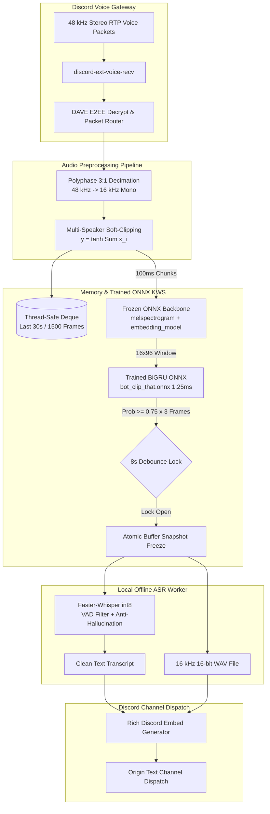

# Discord Voice Clipper & Meeting Assistant Bot
> **100% Offline, Privacy-Preserving Retroactive Voice Clipper and Instant Meeting Minutes Generator for Discord.**

[](https://www.python.org/)
[](https://discordpy.readthedocs.io/)
[-green.svg)](https://github.com/SYSTRAN/faster-whisper)
[-orange.svg)](evaluation_wakeword_report.md)
[](tests/)
[](evaluation_report.md)

---

## 📖 Overview

During collaborative voice meetings, verbal agreements, task assignments, and technical decisions are frequently lost to **"meeting amnesia."** Taking manual notes breaks conversational flow, while traditional cloud recording bots introduce privacy risks, costly API billing, and massive unindexed audio recordings.

**Discord Voice Clipper** solves this by maintaining a thread-safe, in-memory **30-second rolling ring buffer**. When someone speaks the trained wake word:

$$\text{"bot clip that"}$$

The bot continuously spots the wake word locally using a **custom-trained PyTorch BiGRU-Attention classifier on frozen ONNX speech embeddings** (`1.248 ms` mean latency per 100 ms chunk), freezes the preceding 30 seconds of audio, downmixes and soft-clips multi-speaker streams, transcribes the speech completely offline using quantized Faster-Whisper, and posts a structured Discord Embed with the transcript and a 16-bit WAV attachment directly to your text channel.

---

## ✨ Key Features

- **🎯 Custom-Trained Local Wake-Word Model (`"bot clip that"`):** Frozen ONNX speech embedding backbone (`melspectrogram.onnx` + `embedding_model.onnx`) paired with a PyTorch BiGRU-Attention classifier (`bot_clip_that.onnx`) trained on your own voice dataset with sliding-window hard-negative mining (`1.248 ms` per 100 ms chunk, `0.00 FP/hr` on 3.21 hours of unseen open-set audio).
- **🎙️ Built-In Dataset Recorder & 5-Fold LOSO Evaluation:** Interactive 16 kHz mono recorder ([tools/record_dataset.py](file:///d:/dev/discord-voice-clipper/tools/record_dataset.py)) and automated Leave-One-Speaker-Out + noise/acoustic/streaming benchmarks ([train_wakeword.py](file:///d:/dev/discord-voice-clipper/train_wakeword.py), [evaluate_wakeword.py](file:///d:/dev/discord-voice-clipper/evaluate_wakeword.py)).
- **⏱️ Retroactive 30-Second Rolling Buffer:** Continuously overwrites an in-memory circular deque (`1,500` frames @ 20 ms). Audio prior to the trigger is captured retroactively without saving long recordings.
- **🎛️ Multi-Speaker Soft-Clipping & Decimation:** Ingests 48 kHz stereo Discord RTP audio, performs 3:1 polyphase FIR decimation down to 16 kHz mono, and mixes multi-speaker streams with `np.tanh` soft-clipping to prevent digital distortion.
- **⚡ 100% Offline Local ASR:** Powered by `faster-whisper` (CTranslate2 int8 quantization) with an average inference latency of **0.43 seconds** on CPU (Real-Time Factor: **0.073x**).
- **🛡️ Anti-Hallucination & Silence Guards:** Integrated Silero VAD, `condition_on_previous_text=False`, compression ratio checks, and temperature fallback `[0.0, 0.2, 0.4]` eliminate repetition loops.
- **🌐 Bilingual Support:** Native transcription for **English (`en`)** and **Indonesian (`id`)**, switchable on the fly via `!lang`.
- **🔒 Zero Cloud APIs & 100% Privacy:** Zero external speech API calls (no OpenAI API, Google Cloud, or Azure).

---

## 🏗️ System Architecture



---

## 📊 Benchmark & Quantitative Evaluation

### 1. Trained Wake-Word Evaluation (`bot clip that`)
Evaluated on recorded group clips (`85` clips) plus a `3.21`-hour held-out open-set speech/music/noise stream ([evaluation_wakeword_report.md](file:///d:/dev/discord-voice-clipper/evaluation_wakeword_report.md)):

| Metric | Measured Value | Target | Status |
|---|:---:|:---:|:---:|
| **Baseline Clean Accuracy / F1** | **100.0% / 1.000** | > 90% | ✅ Passed |
| **Noise Robustness (20 dB / 10 dB SNR)** | **98.8% / 94.1%** | > 85% | ✅ Passed |
| **Acoustic Shifts (Quiet / Loud / Fast)** | **100.0%** | > 90% | ✅ Passed |
| **Mean Streaming Chunk Latency (100 ms)** | **1.248 ms** | < 20 ms | ✅ Instant |
| **Open-Set False Alarm Rate (3.21 hrs, E5)** | **0.00 FP/hr** (`0` triggers) | < 1.0 FP/hr | ✅ Zero False Alarms |

### 2. Local ASR Benchmark (`faster-whisper` `base` int8)
Evaluated against 10 standardized meeting speech samples ([evaluation_report.md](file:///d:/dev/discord-voice-clipper/evaluation_report.md)):

| Metric | Measured Value | Target | Status |
|---|:---:|:---:|:---:|
| **Average Word Error Rate (WER)** | **4.90%** | < 10.0% | ✅ Exceeded |
| **Average Inference Latency** | **0.43 s** | < 1.50 s | ✅ Exceeded |
| **Real-Time Factor (RTF)** | **0.073x** | < 0.200x | ✅ 13.7x faster than real-time |

---

## 🛠️ Prerequisites & Installation

### 1. System Requirements
- **OS:** Windows 10/11, macOS, or Linux (x86_64).
- **Python:** 3.12 (recommended).
- **RAM:** Minimum 8 GB (16 GB recommended).
- **CPU:** Multi-core x86_64 CPU (CUDA GPU optional).

### 2. Clone and Setup Environment

```powershell
# Clone the repository
git clone https://github.com/Meezuki/discord-voice-clipper.git
cd discord-voice-clipper

# Create and activate Python 3.12 virtual environment
python -m venv venv
.\venv\Scripts\Activate.ps1    # On Windows
# source venv/bin/activate     # On Linux / macOS

# Install required dependencies
pip install -r requirements.txt
```

### 3. Configure Discord Bot Credentials

1. Go to the [Discord Developer Portal](https://discord.com/developers/applications) and create an Application.
2. Under **Bot**, enable **Message Content Intent** under **Privileged Gateway Intents**.
3. Under **OAuth2 URL Generator**, select `bot` with permissions:
   - **Voice:** *Connect*, *Speak*
   - **Text:** *Send Messages*, *Embed Links*, *Attach Files*, *Read Message History*
4. Create a `.env` file in the project root:

```env
DISCORD_TOKEN=your_discord_bot_token_here
```

---

## 🎙️ Recording & Training the Wake-Word Model

See [RECORD_INSTRUCTIONS.md](file:///d:/dev/discord-voice-clipper/RECORD_INSTRUCTIONS.md) for the full teammate recording guide. Quick workflow:

```powershell
# 1. Record your voice samples (repeat for each speaker)
.\venv\Scripts\python.exe tools\record_dataset.py --speaker marco --takes 2

# 2. Rebuild manifest after merging teammates' WAV folders
.\venv\Scripts\python.exe tools\record_dataset.py --rebuild-manifest

# 3. Download backbone (auto-handled) & train + export models/wakeword/bot_clip_that.onnx
.\venv\Scripts\python.exe train_wakeword.py

# 4. Run full wake-word evaluation (exports evaluation_wakeword_report.md)
.\venv\Scripts\python.exe evaluate_wakeword.py
```

---

## 🚀 How to Run and Use

### 1. Launch the Bot

```powershell
.\venv\Scripts\python.exe main.py
```

### 2. Discord Channel Commands

| Command | Description |
|---|---|
| `!join` | Summons the bot to your current voice channel and starts the 30-second rolling buffer. |
| **"bot clip that"** | *(Spoken)* Hands-free wake word. Freezes the last 30 seconds, transcribes, and posts to chat. |
| `!clip` | *(Text command)* Manually freezes the last 30 seconds and generates a clip. |
| `!lang [en\|id\|auto]` | Sets transcription language: `!lang en` (English, default), `!lang id` (Indonesian), or `!lang auto`. |
| `!leave` | Disconnects the bot from the voice channel and safely purges all in-memory buffers. |

---

## 🧪 Running Automated Tests

```powershell
# Run full unit & integration test suite (18/18 tests)
.\venv\Scripts\python.exe -m pytest tests/ -v

# Run ASR WER benchmark
.\venv\Scripts\python.exe evaluate_wer.py

# Run Wake-Word KWS benchmark
.\venv\Scripts\python.exe evaluate_wakeword.py
```

---

## 📁 Repository Structure

```text
discord-voice-clipper/
├── asr_engine.py                    # Quantized Faster-Whisper ASR engine with VAD & hallucination guards
├── audio_sink.py                    # 30-second rolling circular buffer & np.tanh soft-clipping mixer
├── download_model.py                # Downloader for ONNX speech-embedding backbone & background features
├── wakeword_features.py             # Shared streaming & offline ONNX embedding extractor
├── wakeword_metrics.py              # Accuracy, F1, FRR, FAR, ROC-AUC & threshold calibration
├── train_wakeword.py                # PyTorch BiGRU-Attention trainer, LOSO CV & ONNX exporter
├── evaluate_wakeword.py             # Quantitative wake-word evaluation (Baseline, E1–E5)
├── keyword_spotter.py               # Streaming ONNX wake-word spotter ('bot clip that')
├── main.py                          # Discord.py bot client, event handlers, and UI embed dispatcher
├── evaluate_wer.py                  # Quantitative ASR WER & latency benchmark (jiwer)
├── dataset_helper.py                # ASR benchmark dataset manager
├── evaluation_wakeword_report.md    # Quantitative wake-word evaluation output
├── evaluation_report.md             # Quantitative ASR WER evaluation output
├── RECORD_INSTRUCTIONS.md           # Step-by-step dataset recording guide for group members
├── WALKTHROUGH.md                   # Detailed end-to-end user manual
├── requirements.txt                 # Dependencies
├── tools/
│   └── record_dataset.py            # Interactive 16 kHz mono recorder with playback & resume
├── data/
│   ├── wakeword/                    # Group-recorded wake-word WAVs & metadata.json
│   ├── test_dataset/                # Standard meeting audio ASR benchmark samples
│   └── user_test/                   # Real student voice test samples (test_01.wav)
├── models/
│   └── wakeword/                    # melspectrogram.onnx, embedding_model.onnx, bot_clip_that.onnx
└── tests/
    ├── test_asr_engine.py
    ├── test_audio_sink.py
    ├── test_evaluation.py
    ├── test_integration.py
    ├── test_keyword_spotter.py
    ├── test_router_resilience.py
    └── test_wakeword_pipeline.py
```
