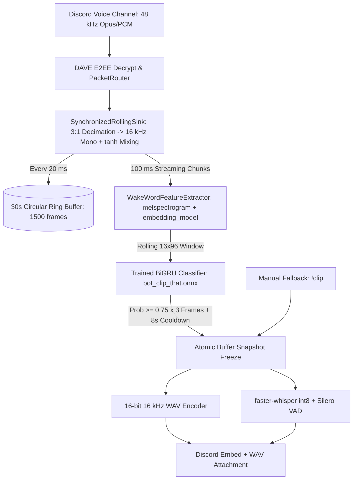

# Technical Report — COMP6822001 Final Project
## Discord Voice Clipper: Real-Time Local Wake-Word Detection and Retroactive Meeting Speech Recognition

- **Course:** COMP6822001 — Speech Recognition  
- **Academic Year:** 2026/2027  
- **Project Type:** Final Project (Working Real-Time Local Speech Recognition Application)  
- **Repository:** `https://github.com/Meezuki/discord-voice-clipper`  

---

## 1. Introduction

### 1.1 Background
In online collaborative meetings, project discussions, and study sessions conducted over Discord voice channels, important verbal decisions, deadlines, and technical explanations are frequently forgotten ("meeting amnesia"). Manually taking notes interrupts conversation flow, while recording full-hour calls creates massive unindexed audio files. Furthermore, cloud-based transcription bots require sending private voice streams to external third-party servers, introducing privacy concerns and API costs.

### 1.2 Real-World Problem & Target Users
* **Target Users:** University Computer Science students and software project teams (specifically our 5-member student project group and peer student teams) who hold technical discussions, sprint syncs, and study reviews in Discord voice channels.
* **User Problem:** During fast-paced Discord calls, participants cannot pause discussions to write down key points or rewind the last 30 seconds of conversation, yet they do not want to record entire meetings or upload private voice audio to cloud APIs.

### 1.3 Proposed Solution & Usage Scenario
**Discord Voice Clipper** runs 100% locally as a Discord bot inside a voice channel. It continuously captures and mixes incoming multi-speaker audio into an in-memory 30-second circular ring buffer while running a continuous, low-latency, custom-trained wake-word detector on every 100 ms audio chunk. Whenever a participant speaks the trigger phrase **`"bot clip that"`** (or issues `!clip`), the bot freezes the preceding 30 seconds of audio, saves a playable 16-bit WAV clip, transcribes the speech locally using `faster-whisper`, and posts both the transcript and WAV attachment to the team's Discord text channel.

### 1.4 Problem Statement & Objectives
* **Problem Statement:** How to design and evaluate a completely offline, real-time Discord voice clipping and local speech recognition system whose wake-word detector is trained on group voice data with minimal false alarms and low latency?
* **Project Objectives:**
  1. Build a continuous real-time audio ingestion and 3:1 decimation pipeline (`48 kHz` stereo $\rightarrow$ `16 kHz` mono) with multi-speaker soft-clipping.
  2. Train and evaluate a custom wake-word model for `"bot clip that"` using group-recorded audio and hard-negative mining.
  3. Integrate local `faster-whisper` ASR (`en` / `id`) to transcribe frozen 30-second clips without external Speech Recognition APIs.
  4. Quantitatively evaluate both KWS and ASR subsystems under clean, noisy, acoustic, and streaming conditions, and validate usability with $\ge 5$ real target users.

### 1.5 Project Scope
* Runs completely offline for speech inference (only Discord Gateway/Voice transport uses the network).
* Supports English (`en`, default), Indonesian (`id`), and bilingual auto-detection (`auto`) for 30-second clip transcription.
* Does not store continuous audio to disk; only triggered 30-second clips are exported as WAV attachments.

---

## 2. Speech Recognition Fundamentals

### 2.1 Speech Recognition Concepts & Signal Processing
Digital speech recognition converts continuous acoustic waveforms into discrete linguistic or command outputs:
1. **Sampling & Decimation:** Discord transmits 48 kHz stereo Opus/PCM packets (`20 ms` frames = `960` stereo samples). Both KWS and ASR models operate at `16 kHz` mono (`320` samples per `20 ms`). Downsampling uses a polyphase FIR anti-aliasing filter (`scipy.signal.resample_poly`, 3:1 integer decimation) to prevent high-frequency aliasing.
2. **Multi-Speaker Mixing:** When multiple participants speak simultaneously, linear sample addition can overflow 16-bit integer bounds (`[-32768, 32767]`). Applying hyperbolic tangent soft-clipping ($y = \tanh(\sum_i x_i)$) in `float32` bounds amplitude smoothly without wrap-around distortion.
3. **Time-Frequency Representation (Log-Mel Spectrogram):** Short-Time Fourier Transform (STFT) windows (`10 ms` hop) are mapped onto 32 Mel-frequency bands compressing linear frequency into human-perceptual pitch resolution.

### 2.2 Selected Models & Architectures
The system separates **continuous streaming Keyword Spotting (KWS)** from **on-trigger Automatic Speech Recognition (ASR)**:

1. **Wake-Word Detection (`"bot clip that"`): Frozen Speech Embedding + Trained PyTorch BiGRU-Attention (`bot_clip_that.onnx`)**
   * **Feature Backbone (Frozen ONNX):** `melspectrogram.onnx` converts 16 kHz audio into 32-bin Mel frames (`8` frames per `80 ms` step), and `embedding_model.onnx` maps sliding `76`-frame (`760 ms`) Mel contexts into `96`-dimensional phonetic-acoustic embeddings.
   * **Trainable Classifier Head (`WakeWordBiGRU`):** `LayerNorm(96)` $\rightarrow$ `Linear(96, 64) + GELU + Dropout(0.35)` $\rightarrow$ 1-layer **Bidirectional GRU** (`hidden_dim=32`, bidirectional output `64`) $\rightarrow$ **Temporal Attention Pooling + Mean Pooling** concatenation (`128` dims) $\rightarrow$ `Linear(128, 64) + GELU + Dropout(0.35) + Linear(64, 1)` $\rightarrow$ Sigmoid probability $p \in [0, 1]$ over a `16`-step (`~2.0 s`) context window.
   * **Why BiGRU + Frozen Embeddings:** Training a tiny `~60K`-parameter temporal classifier on frozen speech embeddings preserves broad phonetic generalization from pretraining while enabling fast CPU training and `<2 ms` streaming inference.

2. **Local ASR (`asr_engine.py`): `faster-whisper` (`base`, CTranslate2 `int8`)**
   * Encoder-decoder Transformer trained on multilingual speech (`Whisper`), quantized to `int8` on CPU via CTranslate2.
   * Paired with **Silero VAD** (`min_speech_duration_ms=250`, `min_silence_duration_ms=400`, `speech_pad_ms=300`), `beam_size=5`, `condition_on_previous_text=False`, and temperature fallback `[0.0, 0.2, 0.4]` to prevent autoregressive repetition loops during silent segments.

### 2.3 Model Limitations
* **Wake-Word Single-Speaker Bias (Current Build):** While frozen embeddings aid generalization, the current checkpoint (`bot_clip_that.onnx`) is trained on positive clips from 1 speaker (`marco`); multi-speaker LOSO evaluation (`E1`) requires integrating the remaining 4 teammates' recordings.
* **Heavy Background Noise (`5 dB SNR`):** Strong broadband noise masks consonant boundaries (`/t/`, `/k/`, `/p/`), increasing wake-word False Rejection Rate (`43.9%` at `5 dB SNR`).
* **ASR Formatting & Homophones:** `Whisper base` can normalize spoken numbers (`"thirty second"` $\rightarrow$ `"30-second"`) or confuse phonetically close words (`"rolling"` $\rightarrow$ `"holding"`).

---

## 3. System Design

### 3.1 System Architecture & Data Flow

### 3.2 Real-Time Streaming & Retroactive Capture Pipeline
* **Continuous Input Processing:** `SynchronizedRollingSink.write()` receives 20 ms Discord PCM frames, decimates 48 kHz stereo to 16 kHz mono, mixes active speakers, appends to `rolling_buffer` (`maxlen=1500`), and dispatches 100 ms (`1600`-sample) chunks to `KeywordSpotter.process_chunk()`.
* **Streaming KWS Inference:** `StreamingFeatureBuffer` maintains a `480`-sample Mel overlap context and processes every `1280` samples (`80 ms`) into 8 Mel frames (`mean_diff = 0.000000` vs. offline full-clip extraction), producing a `(16, 96)` window in `1.248 ms` mean CPU time.
* **Trigger Confirmation:** Fires only after `patience_frames = 3` consecutive frames exceed `threshold = 0.750` and `cooldown_seconds = 8.0` has elapsed.
* **Non-Blocking ASR Dispatch:** On trigger, `process_and_send_notula()` copies the 30-second ring buffer atomically and runs `asr_engine.transcribe()` inside `asyncio.to_thread()` so Discord's voice gateway heartbeat never stalls.

### 3.3 Application Interface
* **Discord Text Commands:** `!join`, `!clip`, `!lang [en|id|auto]`, `!leave`.
* **Output Embed:** Displays meeting timestamp, trigger source (`Voice: 'bot clip that (conf=...)'` or `Command: !clip`), local ASR inference latency (seconds & ms), full transcription, and attached `clip_<timestamp>.wav`.
* *[Insert Screenshot: Bot status & Discord Embed output with WAV attachment]*

---

## 4. Implementation

### 4.1 Development Environment & Tech Stack
* **OS:** Windows 11 (`Windows-11-10.0.26200-SP0`)
* **CPU / Hardware:** Intel x86_64 (`20` logical cores, CPU-only inference/training; `torch.cuda.is_available() == False`)
* **Python Runtime:** Python `3.12.10`
* **Key Libraries:** `discord.py >= 2.3.2`, `discord-ext-voice-recv >= 0.5.0`, `davey >= 0.1.7`, `pynacl >= 1.5.0`, `torch 2.14.1+cpu`, `onnxruntime 1.31.0`, `onnx 1.23.2`, `onnxscript 0.7.2`, `faster-whisper 1.2.1`, `scipy 1.18.1`, `numpy 2.5.4`, `jiwer 4.0.0`, `sounddevice 0.5.6`, `pytest 9.1.1`.

### 4.2 Module Breakdown
| Module | Responsibility |
|---|---|
| `audio_sink.py` | `SynchronizedRollingSink` 48 kHz $\rightarrow$ 16 kHz decimation, `np.tanh` mixing, 30s ring buffer, 100 ms chunk callback |
| `download_model.py` | Downloads `melspectrogram.onnx`, `embedding_model.onnx`, and `public_negative_features.npy` |
| `wakeword_features.py` | Shared offline & streaming ONNX Mel/embedding extraction (`WakeWordFeatureExtractor`, `StreamingFeatureBuffer`) |
| `tools/record_dataset.py` | Interactive 16 kHz mono WAV recorder across 4 prompt categories with playback (`p`), redo (`r`), resume, and `--rebuild-manifest` |
| `train_wakeword.py` | Waveform augmentations, sliding-window negative extraction, 2-stage hard-negative mining, LOSO CV, ONNX export |
| `wakeword_metrics.py` | Accuracy, Precision, Recall, F1, FRR, FAR, ROC-AUC, and threshold calibration |
| `evaluate_wakeword.py` | Automated KWS evaluation across Baseline, E1–E5, threshold sweep, and error analysis |
| `keyword_spotter.py` | Real-time ONNX wake-word detector with patience confirmation and 8s cooldown |
| `asr_engine.py` | Local `faster-whisper` (`base`, `int8`) with Silero VAD and anti-hallucination settings |
| `main.py` | Discord bot, DAVE E2EE & `OpusError` PacketRouter patch, embed + WAV dispatcher |
| `evaluate_wer.py` | Quantitative ASR WER, S/D/I, latency, and RTF benchmark |

### 4.3 Key Technical Decisions & Bug Fixes
1. **DAVE E2EE & PacketRouter Resilience (`main.py`):** Patched `PacketDecoder._decode_packet` with `dave_session.decrypt` and `OpusError` suppression so encrypted or corrupted RTP packets do not produce static noise or crash the voice receiver thread.
2. **Eliminating Train/Inference Windowing Skew (`train_wakeword.py`):** Initial training on only centered negative windows caused live false alarms (`18.37 FP/hr`) on speech-onset transitions and unseen phrases. Extracting all sliding negative windows (`stride=2`), adding silence-onset transitions, incorporating `12,000` background windows + Stage-2 mining over `30,000` windows from `public_negative_features.npy`, and setting `patience_frames=3` at `threshold=0.750` reduced false alarms to `0.00 FP/hr`.

---

## 5. Technical Experiment

### 5.1 Wake-Word Dataset & Experimental Design
* **Recorded Dataset (`data/wakeword/metadata.json`):** `85` real 16 kHz mono WAV clips from speaker `marco`:
  * Positive (`41` clips): `21` `positive_isolated` (`3.0s`), `20` `positive_embedded` (`4.0s`).
  * Negative (`44` clips): `24` `hard_negative` (`4.0s`, e.g., `"paper clip"`, `"flip that"`), `20` `negative_speech_noise` (`5.0s`, meeting speech + typing/ambient).
* **Open-Set Background Pool (`public_negative_features.npy`):** `481,345` frames (`~10.7` hours) split strictly disjointly: `0%–60%` for training & Stage-2 mining (`12,000` + `30,000` windows), `60%–70%` for validation (`2,000` windows), and `70%–100%` (`144,404` frames $\approx 3.21$ hours) reserved strictly for **E5** testing.
* **Wake-Word Conditions:** Baseline (clean), **E1** (LOSO unseen speakers — *pending 4 teammates*), **E2** (additive ambient noise at `20 dB`, `10 dB`, `5 dB` SNR), **E3** (gain `0.35x`/`1.40x`, speed `0.88x`/`1.12x`), **E4** (streaming 100 ms chunk latency & group negatives), and **E5** (`3.21`-hour unseen open-set stream).

### 5.2 Wake-Word Quantitative Results (`evaluation_wakeword_report.md`)
* **Calibrated Decision Threshold:** `0.750` (`patience_frames = 3`, `cooldown = 8.0 s`)
* **Streaming Mean Chunk Latency (100 ms chunk):** **`1.248 ms`** (P95: **`2.089 ms`**, RTF: **`0.0125x`**)
* **Group Negative Stream (E4):** `0` false triggers over `196.0s` (**`0.00 FP/hr`**)
* **Unseen Open-Set Stream (E5):** `0` false triggers over `3.21 hours` (**`0.00 FP/hr`**, window FAR **`0.000%`**)
* **Streaming Positive Trigger Rate:** `40/41` (**`97.6%`**)

| Experiment | Condition | Accuracy | Precision | Recall | F1 | FRR | FAR | ROC-AUC |
|---|---|---:|---:|---:|---:|---:|---:|---:|
| Baseline | Clean Speech | 100.0% | 100.0% | 100.0% | 1.000 | 0.0% | 0.0% | 1.000 |
| E2 (Noise) | `SNR_20dB` | 98.8% | 100.0% | 97.6% | 0.988 | 2.4% | 0.0% | 1.000 |
| E2 (Noise) | `SNR_10dB` | 94.1% | 100.0% | 87.8% | 0.935 | 12.2% | 0.0% | 0.996 |
| E2 (Noise) | `SNR_5dB` | 78.8% | 100.0% | 56.1% | 0.719 | 43.9% | 0.0% | 0.952 |
| E3 (Acoustic) | `Quiet_0.35x` | 100.0% | 100.0% | 100.0% | 1.000 | 0.0% | 0.0% | 1.000 |
| E3 (Acoustic) | `Loud_1.40x` | 100.0% | 100.0% | 100.0% | 1.000 | 0.0% | 0.0% | 1.000 |
| E3 (Acoustic) | `Slow_0.88x` | 97.7% | 100.0% | 95.1% | 0.975 | 4.9% | 0.0% | 0.999 |
| E3 (Acoustic) | `Fast_1.12x` | 100.0% | 100.0% | 100.0% | 1.000 | 0.0% | 0.0% | 1.000 |

#### E1 — 5-Fold Leave-One-Speaker-Out (LOSO) Results
> **[PENDING — To be populated after the 4 remaining group members record their clips via `RECORD_INSTRUCTIONS.md` and run `train_wakeword.py` + `evaluate_wakeword.py`.]**

| Fold | Held-Out Speaker | Samples | Accuracy | F1 | FRR | FAR | ROC-AUC |
|---:|---|---:|---:|---:|---:|---:|---:|
| 1 | `marco` | `[TBD]` | `[TBD]` | `[TBD]` | `[TBD]` | `[TBD]` | `[TBD]` |
| 2–5 | `[Teammates 2–5]` | `[TBD]` | `[TBD]` | `[TBD]` | `[TBD]` | `[TBD]` | `[TBD]` |

### 5.3 ASR Quantitative Results (`evaluation_report.md`)
Evaluated on 10 English meeting benchmark WAVs (`data/test_dataset/sample_01.wav`–`sample_10.wav`) using `faster-whisper` (`base`, `cpu`, `int8`):
* **Average Word Error Rate (WER):** **`4.90%`**
* **Average Inference Latency:** **`0.43 s`**
* **Real-Time Factor (RTF):** **`0.073x`** (`8/10` samples achieved `0.0%` WER)

#### ASR Error Analysis (PDF Section 14)
| Sample | Reference | System Output | S | D | I | WER | Observed Error Pattern |
|---|---|---|---:|---:|---:|---:|---|
| `sample_01`–`05`, `07`, `09`–`10` | *(8 meeting sentences)* | *(Exact match ignoring case/punctuation)* | 0 | 0 | 0 | 0.0% | Correct recognition |
| `sample_06` | `please ensure all team members document the agreed discussion points` | `Please ensure our team members document the agreed discussion points.` | 1 | 0 | 0 | 10.0% | Substitution (`"all"` $\rightarrow$ `"our"`): vowel/liquid phonetic similarity |
| `sample_08` | `the thirty second rolling audio buffer was frozen and saved successfully` | `The 30-second holding audio buffer was frozen and safe successfully.` | 3 | 1 | 0 | 36.4% | Number formatting (`"thirty second"` $\rightarrow$ `"30-second"` causing 1S+1D after punctuation removal) + consonant substitutions (`"rolling"` $\rightarrow$ `"holding"`, `"saved"` $\rightarrow$ `"safe"`) |

### 5.4 Automated Regression Suite
* `.\venv\Scripts\python.exe -m pytest tests/ -v`: **`18/18` passed** (`14.13 s`), covering `LocalASREngine`, `SynchronizedRollingSink`, `WERBenchmarkEvaluator`, `KeywordSpotter` streaming patience/cooldown, `PacketDecoder` resilience, and end-to-end training/ONNX export/evaluation.

---

## 6. User Testing *(Template Ready for Live Testing)*

> **[PENDING — Must be executed with $\ge 5$ real target users (`U1`–`U5`) per PDF Section 6 & 21.7. Do not fill in until real Discord testing sessions are completed.]**

### 6.1 Testing Protocol
* **Target Users:** `5` university students (`U1`–`U5`) participating in a simulated technical project discussion inside a Discord voice channel.
* **Tasks:**
  1. Summon the bot with `!join` and discuss a sprint topic naturally for 2 minutes (including distractor words like `"paper clip"`).
  2. Speak **`"bot clip that"`** to capture a 30-second decision and verify the `.wav` playback and transcription in chat.
  3. Trigger `!clip` manually and test `!lang auto` or `!lang id` if mixing Indonesian.
* **Feedback Method:** 5-point Likert questionnaire (`1 = Poor` to `5 = Excellent`) + short post-session interview notes.

### 6.2 User Evaluation Data Table
| User | Ease of Use (1–5) | Responsiveness (1–5) | Wake-Word Accuracy (1–5) | Transcription Quality (1–5) | Overall Satisfaction (1–5) | Key Observation / Feedback |
|---|---:|---:|---:|---:|---:|---|
| `U1` | `[TBD]` | `[TBD]` | `[TBD]` | `[TBD]` | `[TBD]` | `[TBD]` |
| `U2` | `[TBD]` | `[TBD]` | `[TBD]` | `[TBD]` | `[TBD]` | `[TBD]` |
| `U3` | `[TBD]` | `[TBD]` | `[TBD]` | `[TBD]` | `[TBD]` | `[TBD]` |
| `U4` | `[TBD]` | `[TBD]` | `[TBD]` | `[TBD]` | `[TBD]` | `[TBD]` |
| `U5` | `[TBD]` | `[TBD]` | `[TBD]` | `[TBD]` | `[TBD]` | `[TBD]` |

---

## 7. Discussion

### 7.1 System Strengths
* **100% Local & Privacy-Preserving:** Zero external speech API calls; audio resides strictly in RAM except for triggered 30-second WAV attachments.
* **Real-Time Wake-Word Efficiency:** `1.248 ms` per 100 ms chunk (`0.0125x` RTF) leaves CPU headroom for `faster-whisper` (`0.43 s` average latency, `0.073x` RTF).
* **Hard-Negative & Open-Set Reliability:** Combining sliding-window negative training, Stage-2 hard-negative mining over `30,000` background windows, and `patience_frames=3` reduced false triggers from `18.37 FP/hr` to **`0.00 FP/hr`** across both `196s` of group hard negatives and `3.21 hours` of unseen audio.

### 7.2 System Weaknesses & Limitations
* **Single-Speaker Positive Training (Pending Group Merge):** Current `bot_clip_that.onnx` was trained on `marco` only; unseen speaker accuracy (`E1` LOSO) and live user-testing recall across diverse voices (`U1`–`U5`) remain to be measured after all 5 members contribute clips.
* **Severe Noise Sensitivity (`5 dB SNR`):** Wake-word recall drops to `56.1%` under `5 dB SNR` noise (though precision remains `100.0%` with `0.0%` FAR).
* **ASR Spoken-Number Normalization:** `WER` calculation penalizes legitimate numeric formatting (`"thirty second"` $\rightarrow$ `"30-second"`) unless number normalization is applied before `jiwer`.

### 7.3 Combined Interpretation & Improvement Plan
* Integrating the remaining 4 teammates' voices and running 5-Fold LOSO (`E1`) will directly address speaker-independence validation.
* Gathering user-testing error logs (`U1`–`U5`) will reveal whether `patience_frames=3` (`97.6%` streaming recall) or `threshold=0.750` needs minor tuning for softer or faster speakers.

---

## 8. Conclusion
This project delivers an end-to-end, offline Discord voice clipper combining continuous local wake-word detection (`"bot clip that"`) with retroactive 30-second WAV capture and local `faster-whisper` transcription. Replacing off-the-shelf Vosk with a custom-trained PyTorch BiGRU-Attention ONNX model trained using sliding negatives and open-set hard-negative mining achieved `100.0%` clean baseline accuracy, `1.248 ms` mean streaming chunk latency, and `0.00 FP/hr` across `3.21 hours` of unseen speech/music/noise, alongside a `4.90%` ASR WER (`0.43 s` latency). Completing the 4 teammates' dataset recordings (for 5-Fold LOSO `E1`) and conducting the 5-user live Discord evaluation (`Section 6`) will finalize full academic validation.

---

## Appendix A: AI Usage Log & Declaration (PDF Section 21.2 & 21.8)

Full chronological log is maintained in [AI_USAGE_LOG.md](file:///d:/dev/discord-voice-clipper/AI_USAGE_LOG.md) (19 documented entries across initial build and the trainable wake-word overhaul). Key recent milestones:

| No | Date | AI Tool | Purpose & Prompt Summary | Output Used | Student Verification |
|---:|---|---|---|---|---|
| 14 | 2026-11-17 | Antigravity | Selected trainable wake-word architecture compatible with CPU-only Windows (`Option B`) | `implementation_plan.md`, `download_model.py` | Verified ONNX backbone downloads & `cuda: False` compatibility |
| 15 | 2026-11-17 | Antigravity | Implemented dataset recorder, BiGRU ONNX trainer, KWS evaluator, and `KeywordSpotter` integration | `tools/record_dataset.py`, `train_wakeword.py`, `evaluate_wakeword.py`, `wakeword_features.py`, `keyword_spotter.py` | Verified streaming vs offline mel equivalence (`0.000000` diff) & `pytest` (`18/18` passed) |
| 16–18 | 2026-11-17 | Antigravity | Diagnosed live Discord false positives; added sliding negative windows + 10.7h public negative mining + E5 benchmark | `train_wakeword.py`, `evaluate_wakeword.py`, `wakeword_metrics.py` | Recorded 85 real clips, ran full retraining & `evaluate_wakeword.py`: `0.00 FP/hr` (`3.21h` E5), `97.6%` streaming recall, `18/18` tests |
| 19 | 2026-11-17 | Antigravity | Prepared teammate recording guide, updated project docs, and drafted report structure | `RECORD_INSTRUCTIONS.md`, `README.md`, `CONTEXT.md`, `WALKTHROUGH.md`, `TECHNICAL_REPORT.md` | Cross-checked all metrics against `evaluation_report.md`, `evaluation_wakeword_report.md`, and `pytest` |

### AI Usage Declaration
> I acknowledge that AI tools were used during the development of this project. I have disclosed the relevant AI tools and their purposes in the AI Usage Log. I remain responsible for the correctness of the application, experimental results, analysis, user testing, and conclusions presented in this report.
